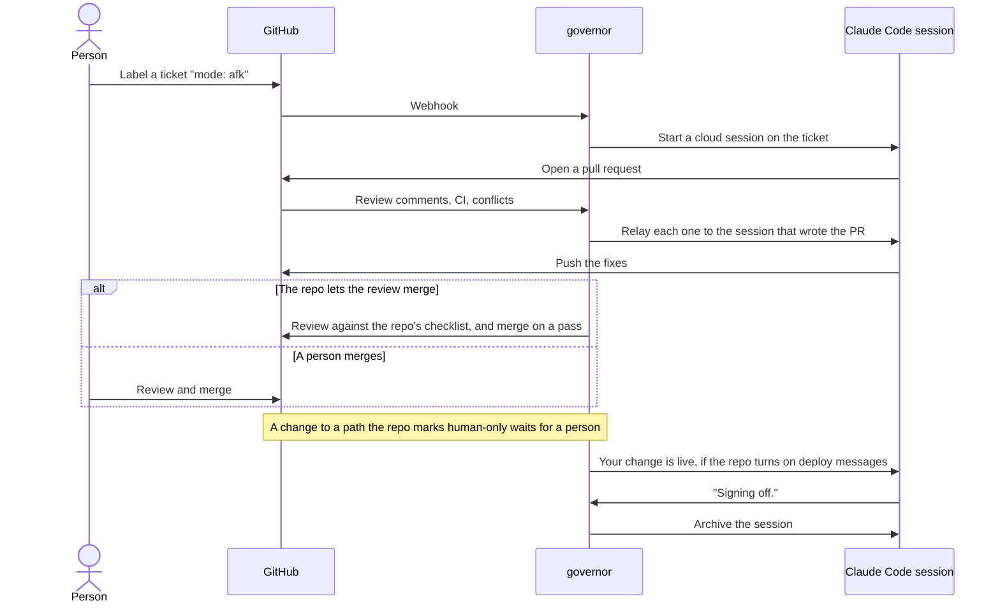
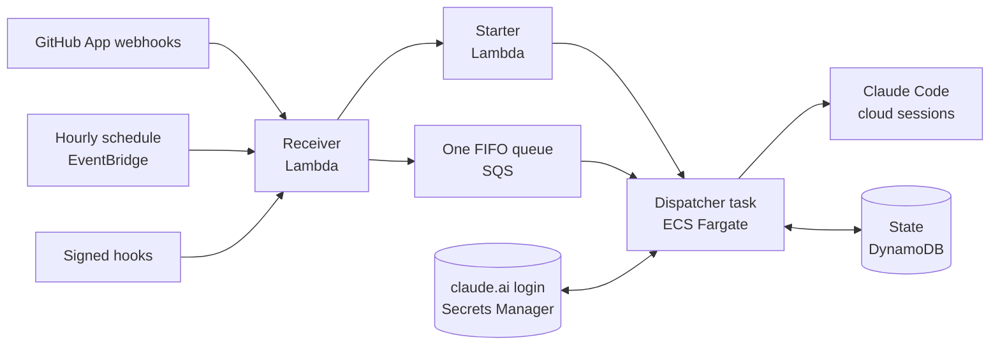

# governor

**A personal software factory, built on Claude Code.** Label an issue in one of your repos, and an AI agent writes the pull request, answers its review, fixes what breaks, and signs off once the change ships. You decide, repo by repo, how much of that happens without you.

[](https://github.com/t-d-d/gh-governor/actions/workflows/deploy.yml)
[](LICENSE)
[](docs/building-with-agents.md)

Coding agents can write a pull request. The work around one is still manual: picking the next ticket, starting the agent, passing on review comments, telling it CI went red or the deploy shipped. Governor does that work for one developer and their repos, as a team lead does for a team. It watches each of your repos that installs its GitHub App, starts a Claude Code cloud session on your own subscription for each ready ticket, and relays everything that happens on that ticket's pull request back to the session that wrote it.

The name comes from the governor on a steam engine, which holds the engine's speed with nobody at the throttle ([more below](#why-governor)).

## Who built it, and where it came from

Governor is [Thomas Dickinson](https://www.linkedin.com/in/thomasdaviddickinson/)'s personal software factory, distilled from running a production service that agents build.

**The service.** Thomas founded and runs a paid article-to-podcast service, live on the web, iOS, macOS and Android, and inside Claude, ChatGPT and Gemini. Coding agents write all of its code, TypeScript on AWS serverless, and automated checks decide what merges. Thomas's approval sits on the specification, before the code exists. Every agent session is archived and evaluated afterwards. The practices, skills and automations that run that backlog were distilled into governor. Governor serves that repo with its PR review on and `merge` on, so most pull requests merge with no person, and the repo's review rules name the paths that still wait for one. The service's repo stays private.

**Before that.** For eight years Thomas was Engineering Manager and Platform Lead for Standard Chartered Bank's delivery platform, in Singapore and London: CI/CD and release engineering for more than 800 applications, run by a team of up to 16 engineers across Singapore, the UK and India. Manual release gates became automated checks, designed with the security and risk teams, and teams' lead time to production fell from months to weeks, and in places to days. Governor applies the same idea to agents: specification first, quality built into the pipeline as automated checks, and a person's approval only where no check can replace it.

Thomas designed governor and the rules its agents work under, shapes and approves every PRD and its technical design, and merges every pull request in this repo. Claude Code sessions write the code. [LinkedIn](https://www.linkedin.com/in/thomasdaviddickinson/) · [GitHub](https://github.com/t-d-d)

## It builds itself

On 28 October 2026 governor's code moved into this repo: about 14,700 lines of source and 1,360 tests. Since then governor has worked its own backlog. In the five days to 12:00 UTC on 2 November 2026:

- governor picked up **94 tickets** and started a Claude Code session on each;
- Thomas merged **98 pull requests** written by Claude Code sessions, from those tickets and from sessions started by a mention or by hand. Over the 90 tickets they closed, pickup to merge took a median of **29 minutes**, review included;
- **none** of those pull requests was reverted, and only **2** of the sessions' pull requests were closed unmerged, neither of them rejected work;
- the code grew by about **7,300 lines of source and 900 tests**, to more than 2,200 tests, every one of them offline.

Each session reviews its own diff before it pushes. Thomas then reviews each pull request by weighing the net complexity it adds against the value of the change. Its description makes that quick to judge: it lists what the change adds and removes, says whether the system got simpler or more complex and what the complexity buys, and maps every acceptance criterion to the test or check that answers it. Thomas often merges in batches, so these times include waiting for review. This repo leaves governor's own PR review off, so every merge is a person's. [How this repo is built](docs/building-with-agents.md) has the full numbers, and the switches this repo turns on.

### One feature, start to finish

The `Blocked until:` feature ([PRD #185](https://github.com/t-d-d/gh-governor/issues/185)) was split into four tickets. #187 was blocked by #186, and #188 and #189 were both blocked by #187. Governor picked up each blocked ticket within two minutes of its blocker's pull request merging:

| Ticket | Picked up (UTC) | Pull request | Merged (UTC) |
|---|---|---|---|
| [#186](https://github.com/t-d-d/gh-governor/issues/186) Hold a ticket on its `Blocked until:` line | 1 Nov 23:03 | [#213](https://github.com/t-d-d/gh-governor/pull/213), 15 files | 2 Nov 07:59 |
| [#187](https://github.com/t-d-d/gh-governor/issues/187) Act when a ticket's wait ends | 2 Nov 08:00 | [#231](https://github.com/t-d-d/gh-governor/pull/231), 21 files | 2 Nov 09:07 |
| [#188](https://github.com/t-d-d/gh-governor/issues/188) Show a ticket's wait in its sidebar | 2 Nov 09:08 | [#235](https://github.com/t-d-d/gh-governor/pull/235), 11 files | 2 Nov 10:55 |
| [#189](https://github.com/t-d-d/gh-governor/issues/189) Wait a number of days after a blocker closes | 2 Nov 09:08 | [#236](https://github.com/t-d-d/gh-governor/pull/236), 14 files | 2 Nov 10:45 |

#213 opened 14 minutes after pickup, then waited almost nine hours, overnight, for review.

[How this repo is built](docs/building-with-agents.md) shows the loop each ticket goes through, and the files that keep the agents on track.

## How it works

In this repo, the label `mode: afk`, for away from keyboard, marks a ticket an agent may take on its own.



### Why not just use an agent you assign or mention?

Tools such as GitHub's Copilot coding agent and the Claude Code GitHub Action write a change when a person assigns them an issue or mentions them, and answer the review comments addressed to them, and a Claude Code cloud session can watch its own pull request. Governor does not drive those tools. It starts its own Claude Code cloud sessions and orchestrates the loop around the change:

- **It finds the work.** It takes tickets from the backlog unasked, and holds one while its blockers are open or its date has not come.
- **One session per ticket, for the ticket's whole life.** The agent that wrote the code also hears when the default branch goes red after its merge, when another merge conflicts with its branch, and when its change ships.
- **Rules per repo.** Each repo sets how far the factory runs and which paths need a person.
- **Your own accounts.** It runs on your Claude subscription and your AWS account.

## What it does

A repo turns each feature on with a switch in its `.github/dispatch.json`. Two behaviours are always on: sign-off, and the `Blocked until:` hold.

| Feature | What happens |
|---|---|
| Pickup | A ticket labelled ready, with no open blocker, gets a Claude Code session of its own. |
| Summons | `@claude` in an issue, a comment or a review starts a session on that remark. |
| PR messages | Every comment, review, push and merge on a pull request goes to the session that wrote it. A fresh session takes over if that one is archived. |
| CI and deploys | A red build tells the sessions whose merges may have broken it. A deploy tells the sessions whose work it shipped, and labels their tickets. |
| PR review | A model checks each pull request against the repo's own checklist, from its description, the list of files it changes and the tickets it closes, and CI checks the code. A pass merges it, or approves it for a person to merge. |
| Periodics | Recurring sessions, such as a code review every 10 merges or a weekly ticket review. |
| Hooks | A system outside GitHub, such as a cloud alarm, starts a session with a signed request. |
| Waits | A ticket that opens with `Blocked until: 2026-11-20` is not started before that date. |
| Sign-off | A session whose last reply ends `Signing off.` is archived. |

### How dark the factory runs

A dark factory runs with the lights off, because nobody works on the floor. Each repo chooses how close to that it gets, and how much human-in-the-loop review it keeps:

| The repo turns on | What is left for a person |
|---|---|
| Pickup and PR messages | Review and merge every pull request. This repo runs this way. |
| The PR review, with `merge` off | Merge the pull requests the model approved. |
| The PR review, with `merge` on | Only what the review cannot pass, such as a change to a human-only path. The production service's repo runs this way, and most of its pull requests merge with no person. |

The rules for what a person keeps are plain config. [The test fixture's file](test/fixtures/factory/.github/dispatch.json) shows what they look like for a repo with the merge on: 37 human-only paths, each with its reason. They cover the architectural rules, the agents' own instructions and skills, the infrastructure, and the deploy and promotion gates.

## Under the hood

Every event governor acts on, a GitHub webhook, the hourly schedule or a signed hook, becomes a *fire*: one message on a queue, which the dispatcher task runs as one turn.



Some of the problems it solves, for engineers building something similar:

- **A Fargate task, not a Lambda.** `claude --cloud` will not run without a terminal, and Lambda has no pseudo-terminal. The task starts when a fire is queued and exits after a minute idle, so the AWS bill is a fraction of a cent a fire.
- **One login, one lane.** Every turn refreshes a single stored claude.ai login, and each refresh rotates the token, so two turns at once would leave one holding a dead login. Every fire goes through one FIFO queue to one task, one turn at a time.
- **Code decides before the model does.** The PR review checks the tickets a pull request closes, its human-only paths and its required checks in code, before any model call. The model has no tools, answers in a fixed JSON shape, and judges only what code cannot.
- **Code review is the repo's, not governor's.** Governor does not decide where code gets reviewed. This repo reviews it before every push: the `pre-push` skill has the session review its own diff at high effort, and each finding ends fixed, filed as an issue, or dismissed only after the session has traced it through the code or run it. The PR review's model reads no diff. It reads the description, the tickets and the list of changed files, and judges whether the change does what its tickets ask. The only file text it reads is a rule file the repo lists in `review.quote`, whole before and after the change, to judge whether a rule changed. The code itself is judged by the repo's CI and required checks, which the review will not pass while red.
- **Relayed text names who wrote it, a check on prompt injection.** Every message governor relays into a session opens with a line saying it came from GitHub, not from the operator, so the session weighs each quoted remark by who wrote it. The line does not tell the session to ignore the text, since a remark from the pull request's owner is work to do. Only people with a say in the repo can summon a session. A hook's prompt lives in the repo, where a pull request reviews it, and the caller's text is quoted as data.
- **Hook keys governor never stores.** Each hook's key is derived from one secret, the repo, the hook and a version, so revoking a key is a one-line pull request. A per-hour cap stops a leaked key flooding the shared queue, and a test checks that a signed request expires before the queue forgets it.
- **A heartbeat that runs somewhere else.** Governor cannot report that it has stopped, so a served repo can run a checker on GitHub Actions that opens an issue when a sweep or a recurring session is overdue.

Two CloudFormation stacks hold all of it, and GitHub Actions deploys them after the gate passes on `main`, then runs a probe in the new task. The code is Node.js, typed with JSDoc and checked by TypeScript, with a small Python launcher for the terminal. [How governor works](docs/how-it-works.md) covers each part in depth.

**[Watch a GitHub event travel through the system, animated](https://t-d-d.github.io/gh-governor/fire-lane.html)**, from the webhook to the queue and the task.

## Personal, on purpose

Governor is built for one developer running their own repos on their own Claude subscription. It is not a team or enterprise product, and does not try to be. One login, one queue and one task are enough for one person's backlog, and they keep the moving parts few. What that choice costs:

- **This repo does not run the automatic merge.** Governor does not review its own pull requests, since it would be marking its own work, so a person merges every one here. The production service's repo does run it.
- **It depends on Claude Code internals.** Governor starts a session by driving `claude --cloud` in a pseudo-terminal, with flags the CLI does not document, and reads a session's last reply from the sessions API. A CLI release can break it. The probe after each deploy, and 17 CloudWatch alarms, are how that shows up.
- **Your login, your terms.** Every session runs on your own claude.ai login, copied from an interactive sign-in, so governor is for your own repos, not a service for other people. Check your plan's terms before you leave it running unattended. The operator mints it again about every two weeks, and an alarm warns three days ahead. The subscription's usage limits, not AWS, set the real ceiling on throughput and cost.
- **Nobody else runs it yet.** [Running your own governor](docs/self-hosting.md) has every step, but only its author has deployed it.
- **One lane.** One task runs one turn at a time, and the hourly sweep starts at most two ticket sessions by default. That keeps the login safe and is plenty for one person's repos. A team version would need a login per developer, a lane per login, and a lease on each login in place of one task at a time.

## Use the playbook without governor

Most of what keeps the agents on track here is plain files that work in any repo with Claude Code:

- [CLAUDE.md](CLAUDE.md): the rules every session reads first, such as scope, tests first, and what only the owner may do.
- [.claude/skills/](.claude/skills/): `fetch-ticket` gathers a ticket's full context, `constraints` has the agent read the relevant rules before it edits code, `pre-push` runs the gate and a code review before every push, and `pr-description` writes a pull request a reviewer can judge in one screen.
- [docs/constraints/](docs/constraints/README.md): architectural rules in a fixed format, including the alternatives that were rejected and why, each held by `fitness:` tests that fail the gate when a change breaks the rule.
- [The pull request template](.github/pull_request_template.md): a table that maps each acceptance criterion to the test that answers it.

[How this repo is built](docs/building-with-agents.md) explains how they fit together.

## Run your own

Each deployment is one person's factory: it serves the GitHub accounts on its owner list, on one Claude subscription. To try it, you deploy your own. You need an AWS account you can administer, the AWS CLI, Node 22.18 or later, the Claude Code CLI, and a Claude Pro or Max subscription.

1. **Deploy governor.** Create a GitHub App, apply two CloudFormation stacks, and save a claude.ai login. [Running your own governor](docs/self-hosting.md) has every step.
2. **Opt a repo in.** Install the App, and copy the [starter kit](examples/starter/) into the repo's `.github/`. The smallest working config is:

   ```json
   {
     "environment": "my-env",
     "labels": { "ready": ["mode: afk"], "claim": "claimed" },
     "features": { "pickup": true, "summons": true, "prMessages": true, "subscribeMessages": true }
   }
   ```

3. **Label a ticket `mode: afk`.** Governor starts a session on it, and comments the session's link on the ticket.

## Documentation

| Page | Read it to |
|---|---|
| [Serving a repo](docs/serving-a-repo.md) | Opt a repo in, and look up every key and switch in `dispatch.json`. |
| [Running your own governor](docs/self-hosting.md) | Deploy governor to your own AWS account. |
| [Hooks](docs/hooks.md) | Start a session from outside GitHub with a signed request. |
| [How governor works](docs/how-it-works.md) | See what each fire does, what each message says, and what each alarm means. |
| [How this repo is built](docs/building-with-agents.md) | Run a repo the way this one runs, with agents writing the code. |
| [Constraints](docs/constraints/README.md) | Read the architectural rules the code keeps, and the tests that hold them. |

## Why "governor"?

A governor is the part of an engine that holds its speed steady with nobody at the throttle. On James Watt's steam engines, two weights spin on a shaft the engine drives. When the engine speeds up they swing out and close the steam valve, and when it slows they drop and open it. James Clerk Maxwell's 1868 paper *On Governors* is often taken as the start of control theory. The word comes, through Latin, from the Greek *kybernētēs*, the steersman, which is also where Norbert Wiener took the name cybernetics in 1948.

This governor does that job for a software factory. Agents do the work, and each repo's config file sets the limits: which tickets they may start, whether a passing review merges, and which files wait for a person.

## Licence

Apache-2.0. See [LICENSE](LICENSE).
