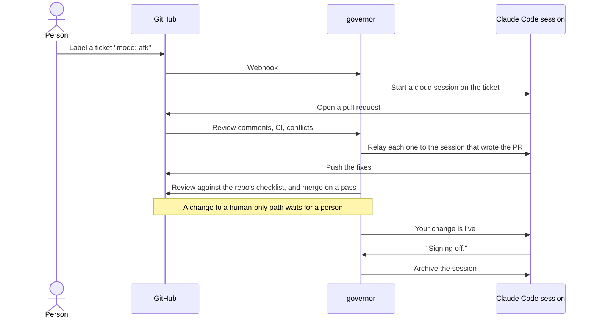
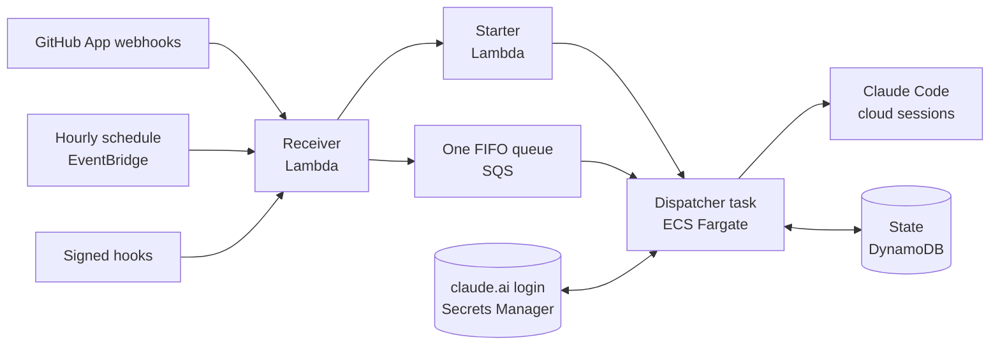

# governor

**A software factory for GitHub repos, built on Claude Code.** Label an issue, and an AI agent writes the pull request, answers its review, fixes what breaks, and signs off once the change ships. Each repo decides how much of that happens without a person.

[](https://github.com/t-d-d/gh-governor/actions/workflows/deploy.yml)
[](LICENSE)
[](docs/building-with-agents.md)

Coding agents can write a pull request. The work around one is still manual: picking the next ticket, starting the agent, passing on review comments, telling it CI went red or the deploy shipped. Governor does that work, as a team lead does for a team of developers. It watches each repo that installs its GitHub App, starts a Claude Code cloud session for each ready ticket, and relays everything that happens on that ticket's pull request back to the session that wrote it.

## Governor builds itself

Governor works on its own repo. This repo's history starts on 28 October 2026, when governor's code moved here. In the six days to 2 November 2026:

- **102** pull requests merged, **99** of them written by Claude Code sessions.
- **94** tickets governor picked up from its own backlog.
- **207 of 211** commits authored by Claude, merges aside.
- **2,261** tests, in about 30,000 lines, against about 22,000 lines of source.

The owner writes the specs and tickets, and reviews and merges every pull request. Agents write the code and the tests. [How this repo is built](docs/building-with-agents.md) shows the loop, and the files that keep the agents on track.

## How it works



## Why "governor"?

A governor is the part of an engine that holds its speed steady with nobody at the throttle. On James Watt's steam engines, two weights spin on a shaft the engine drives. When the engine speeds up they swing out and close the steam valve, and when it slows they drop and open it. James Clerk Maxwell's 1868 paper *On Governors* is often taken as the start of control theory. The word comes, through Latin, from the Greek *kybernētēs*, the steersman, which is also where Norbert Wiener took the name cybernetics in 1948.

This governor does that job for a software factory. Agents do the work, and each repo's config file sets the limits: which tickets they may start, whether a passing review merges, and which files always wait for a person.

## How dark the factory runs

A dark factory runs with the lights off, because nobody works on the floor. Each repo chooses how close to that it gets:

| The repo turns on | What is left for a person |
|---|---|
| Pickup and PR messages | Review and merge every pull request. This repo runs this way. |
| The PR review, with `merge` off | Merge the pull requests the model approved. |
| The PR review, with `merge` on | Only what the review cannot pass, such as a change to a human-only path. |

## What it does

A repo turns each feature on with a switch in its `.github/dispatch.json`. Sign-off and the `Blocked until:` hold need none.

| Feature | What happens |
|---|---|
| Pickup | A ticket labelled ready, with no open blocker, gets a Claude Code session of its own. |
| Summons | `@claude` in an issue, a comment or a review starts a session on that remark. |
| PR messages | Every comment, review, push and merge on a pull request goes to the session that wrote it. A fresh session takes over if that one is archived. |
| CI and deploys | A red build tells the sessions whose merges may have broken it. A deploy tells the sessions whose work it shipped, and labels their tickets. |
| PR review | A model reviews each pull request against the repo's own checklist. A pass merges it, or approves it for a person to merge. |
| Periodics | Recurring sessions, such as a code review every 10 merges or a weekly ticket review. |
| Hooks | A system outside GitHub, such as a cloud alarm, starts a session with a signed request. |
| Waits | A ticket that opens with `Blocked until: 2026-11-20` is not started before that date. |
| Sign-off | A session whose last reply ends `Signing off.` is archived. |

## Under the hood



Some of the problems it solves, for engineers building something similar:

- **A Fargate task, not a Lambda.** `claude --cloud` will not run without a terminal, and Lambda has no pseudo-terminal. The task starts when a fire is queued and exits after a minute idle. A fire costs a fraction of a cent, and no GitHub Actions minutes.
- **One login, one lane.** Every turn refreshes a single stored claude.ai login, and each refresh rotates the token, so two turns at once would leave one holding a dead login. Every fire goes through one FIFO queue to one task, one turn at a time.
- **Code decides before the model does.** The PR review checks the tickets a pull request closes, its human-only paths and its required checks in code, before any model call. The model judges only what code cannot.
- **Relayed text is marked as data.** Every message governor relays into a session opens with a line naming where its text came from, so the session weighs each quoted remark by who wrote it. A hook's prompt lives in the repo, where a pull request reviews it, and the caller's text is quoted as data.
- **Hook keys governor never stores.** Each hook's key is derived from one secret, the repo, the hook and a version, so revoking a key is a one-line pull request. A per-hour cap stops a leaked key flooding the shared queue, and a test checks that a signed request expires before the queue forgets it.
- **A heartbeat that runs somewhere else.** Governor cannot report that it has stopped, so each served repo runs a checker on GitHub Actions that opens an issue when a sweep or a recurring session is overdue.

Two CloudFormation stacks hold all of it, and GitHub Actions deploys them after the gate passes on `main`. [How governor works](docs/how-it-works.md) covers each part in depth, and [the fire lane](https://t-d-d.github.io/gh-governor/fire-lane.html) animates a fire's path from the receiver to the task.

## Try it

Governor serves the GitHub accounts on its deployment's owner list, so you run your own. You need an AWS account you can administer, the AWS CLI, Node 22.18 or later, the Claude Code CLI, and a Claude Pro or Max subscription.

1. **Deploy governor.** Create a GitHub App, apply two CloudFormation stacks, and save a claude.ai login. [Running your own governor](docs/self-hosting.md) has every step.
2. **Opt a repo in.** Install the App, and copy the [starter kit](examples/starter/) into the repo's `.github/`. The smallest working config is:

   ```json
   {
     "environment": "my-env",
     "labels": { "ready": ["mode: afk"], "claim": "claimed" },
     "features": { "pickup": true, "summons": true, "prMessages": true, "subscribeMessages": true }
   }
   ```

3. **Label a ticket `mode: afk`.** Governor starts a session on it, and comments the session's link on the ticket.

## Documentation

| Page | Read it to |
|---|---|
| [Serving a repo](docs/serving-a-repo.md) | Opt a repo in, and look up every key and switch in `dispatch.json`. |
| [Running your own governor](docs/self-hosting.md) | Deploy governor to your own AWS account. |
| [Hooks](docs/hooks.md) | Start a session from outside GitHub with a signed request. |
| [How governor works](docs/how-it-works.md) | See what each fire does, what each message says, and what each alarm means. |
| [How this repo is built](docs/building-with-agents.md) | Run a repo the way this one runs, with agents writing the code. |
| [Constraints](docs/constraints/README.md) | Read the architectural rules the code keeps, and the tests that hold them. |

## Who built it

Governor is designed and run by [Thomas Dickinson](https://github.com/t-d-d), who writes its specs and tickets, sets the rules its agents work under, and reviews every pull request. Claude Code sessions write the code.

## Licence

Apache-2.0. See [LICENSE](LICENSE).
